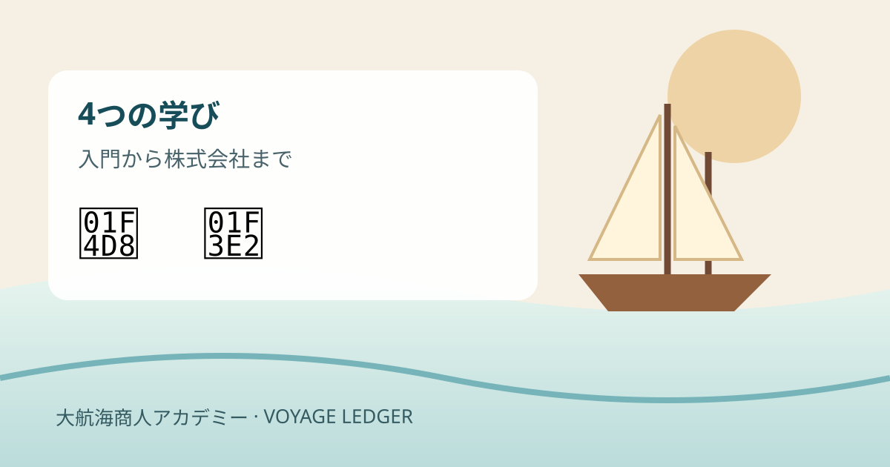
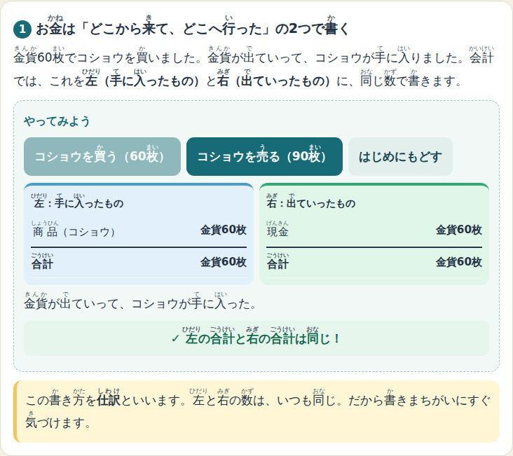
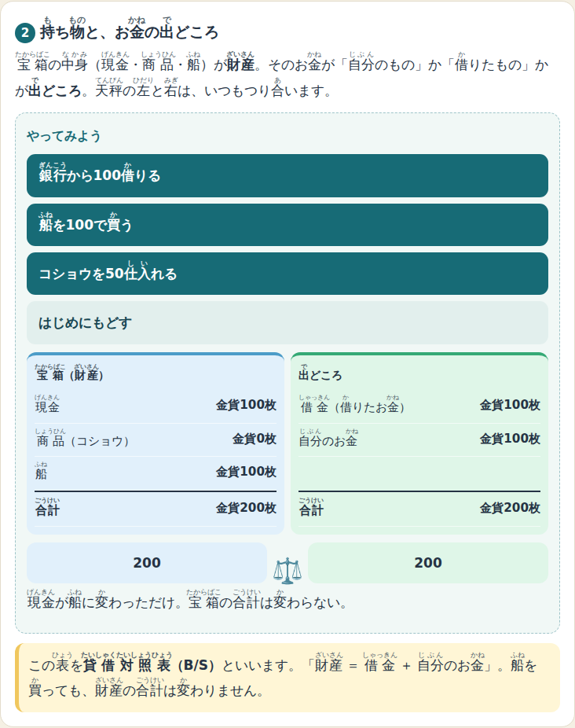
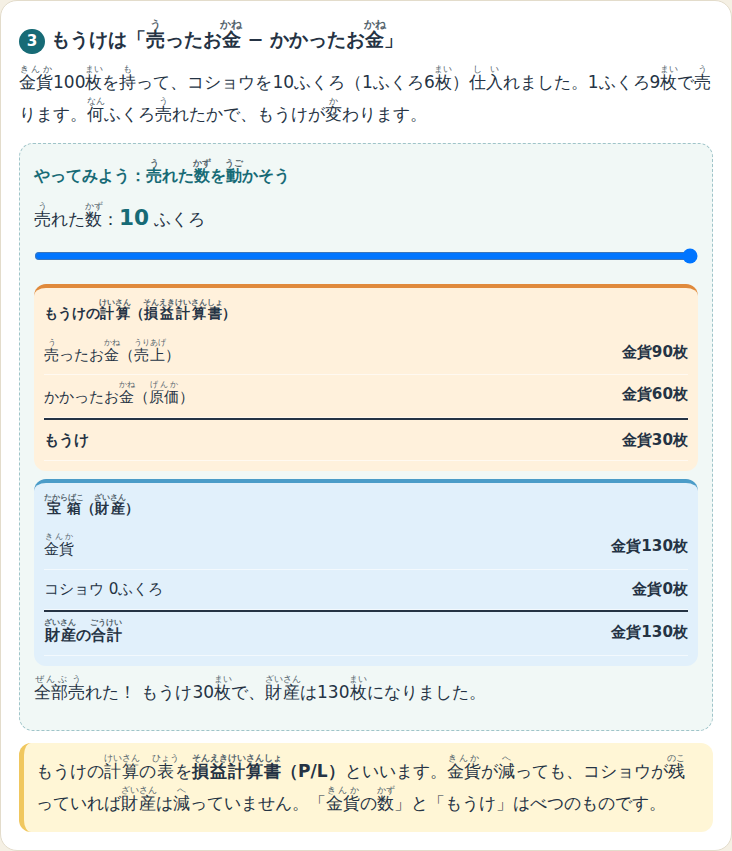
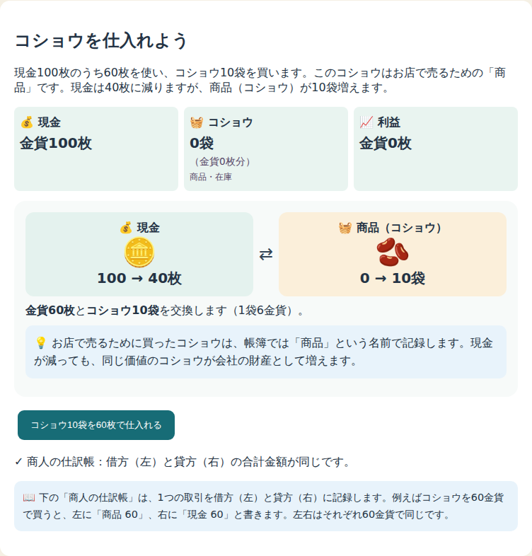
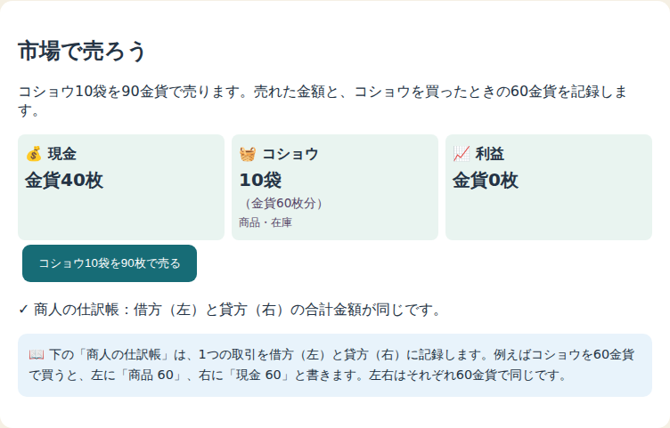
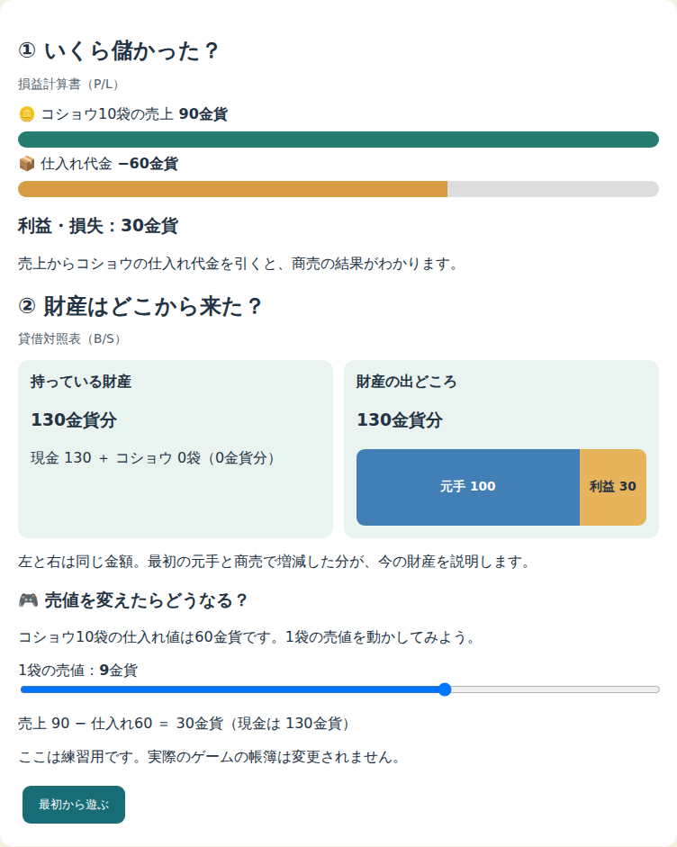
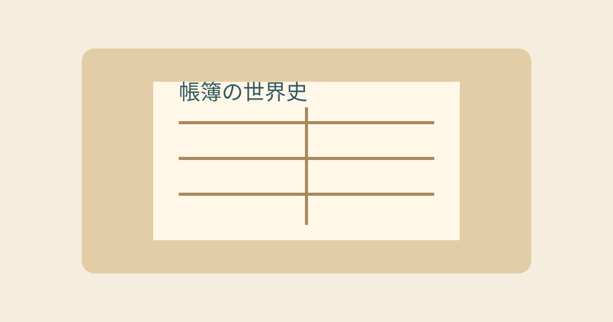
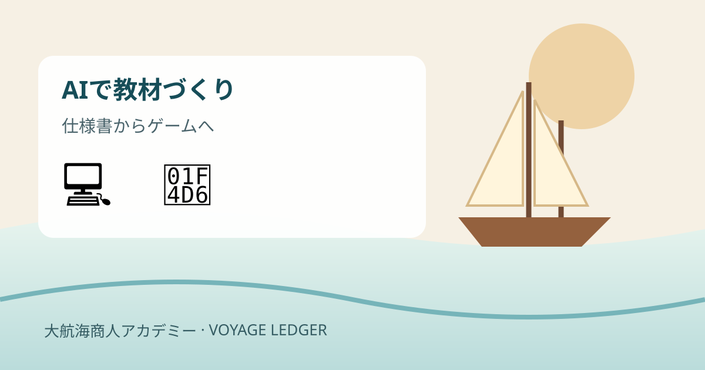
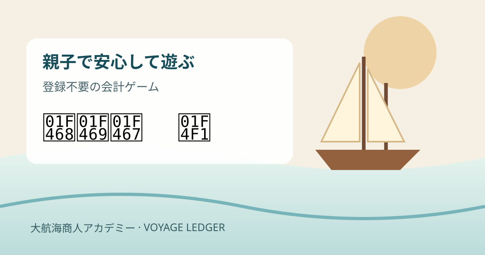

# 小学生が「複式簿記」を遊んで学べる無料ゲームを作りました ― 大航海商人アカデミー

「お金の勉強をさせたいけれど、何から始めればいいかわからない」。
そんな気持ちから、小学生が遊びながら会計の考え方を身につけられるブラウザゲームを作りました。
無料・登録不要・広告なしで、スマホでもパソコンでも遊べます。

👉 **大航海商人アカデミー** https://adash333.github.io/voyage-ledger/

## どんなゲーム？

舞台は1500年ごろの地中海。子どもは商人になって、コショウなどの商品を港で仕入れ、別の港で売ります。
取引をするたびに「仕訳帳（しわけちょう）」が自動で書かれ、「損益計算書（P/L）」と「貸借対照表（B/S）」が更新されます。

ポイントは、**取引を確定する前に「金貨・商品・利益がどう変わるか」を予想してから確定する**こと。
「金貨が減ったのに、損をしていない」「金貨が増えたのに、もうけは少ない」といった、大人でも混乱しがちな感覚を、数字で何度も確かめられます。

## レベルに合わせて4段階

| 段階 | ページ | 学べること |
|---|---|---|
| 入門 | かいけい いちばんやさしい きょうかしょ | お金の動きを「2つの面」から見る考え方。全漢字にふりがな付き、小学3年生から |
| 初級 | こしょうやさん／大航海商人アカデミー | 仕入れ→販売の3ステップで、仕訳帳と決算書の読み方 |
| 中級 | 自由経営モード | 4つの港の相場を比べて、自分で商品と数量を決める。先入先出法の在庫、航海費 |
| 上級 | 株式会社版 | 銀行からの借入と利息、船の減価償却、株式発行と配当、そして会社を売る「エグジット」 |

上級の株式会社版には「やさしい」と「本気」の2つの難易度があります。
本気モードでは金利と航海費が上がるかわりに受取利息がもらえ、条件を満たすと会社を売却して手取りを計算する「エグジット」に挑戦できます。
「会社の値段は、持っている財産だけでなく、これからのもうけへの期待でも決まる」ことを、自分の会社で体験できます。

英語版もあるので、英語学習と組み合わせることもできます。

## 入門の遊び方：まずは5分で会計の基本を体験

[📘 入門「かいけい いちばんやさしい きょうかしょ」を開く](https://adash333.github.io/voyage-ledger/learn/)

小学3年生くらいからを想定した、ふりがな付きのページです。画面上部の「ふりがな：あり／なし」で切り替えられます。最初は上から順に5つの練習を進めましょう。

### 1. 金貨60枚でコショウを買ってみる

「コショウを買う（60枚）」を押します。左には手に入った「商品 60」、右には出ていった「現金 60」が表示されます。左右が同じ60枚になることを確かめます。続いて「コショウを売る（90枚）」を押し、売上と仕入れ代金の記録がどう増えるか見てみましょう。「はじめにもどす」で何度でも試せます。

**画面で見る場所：** 「やってみよう」のボタンと、その下の青い左欄・緑の右欄。

### 2. 財産とお金の出どころを比べる

「銀行から100借りる」を押すと、現金と借金が両方100増えます。「船を100で買う」を押すと、現金が船に変わります。画面の天秤と左右の合計を見て、**財産＝借金＋自分のお金**が成り立つことを確かめましょう。これが貸借対照表（B/S）の考え方です。

### 3. スライダーで利益を計算する

「売れた数」を0袋から10袋まで動かします。コショウは1袋6枚で仕入れ、9枚で売る設定です。10袋売ると売上90枚、原価60枚、利益30枚。現金の残りと利益が必ずしも同じではないことがわかります。これが損益計算書（P/L）です。

### 4. 船の値段が少しずつ減ることを知る

「1回 航海する」を押します。500枚で買った船の帳簿上の価値が1航海につき25枚ずつ減り、費用として計上されます。金貨がその場で減らないのに費用が増える「減価償却」を体験できます。

### 5. 借入と株式を比べ、クイズで確認

「銀行から100借りる」と「仲間に100出してもらう」を交互に押し、返済・利息と配当の違いを比べます。最後に「ことばカード」をタップし、「どっちが正しい？」のクイズに答えてみましょう。

## 初級の遊び方：コショウ商人になって利益30枚を目指そう

[⛵ 初級「大航海商人アカデミー」を開く](https://adash333.github.io/voyage-ledger/)

入門で「左と右」の意味がわかったら、初級の物語を始めましょう。最初は現金も商品も0です。画面上部の「現金」「コショウ」「利益」と、下の「商人の仕訳帳」「損益計算書（P/L）」「貸借対照表（B/S）」を見比べながら進めます。

### ステップ1：商会を設立する

「金貨100枚で商会を設立」を押します。現金が100枚になり、仕訳帳に「借方：現金100／貸方：資本金100」が記録されます。会社の財産100枚が、自分の出した元手100枚から来たことを確認します。

### ステップ2：コショウ10袋を仕入れる

「コショウ10袋を60枚で仕入れる」を押します。現金は100→40枚、コショウは0→10袋（60枚分）になります。**現金は減っても、商品という財産が増えたため、まだ損失ではありません。** 仕訳帳の行をタップすると説明を読めます。

### ステップ3：コショウを90枚で販売する

「コショウ10袋を90枚で売る」を押します。現金は40→130枚、在庫は0袋に。売上90枚から仕入れ代金60枚を引いて、利益は30枚です。P/Lに利益30枚、B/Sに現金130枚と「元手100＋利益30」が表示されることを確かめましょう。

### おまけ：売値を変えてみる

ページ下部の「売値を変えたらどうなる？」で、1袋の売値を3〜12枚に動かせます。売値6枚なら利益0枚、9枚なら30枚、12枚なら60枚。これは練習用で、ゲームの帳簿には影響しません。

**低学年向けには** [「こしょうやさん」](https://adash333.github.io/voyage-ledger/kids/) もあります。ひらがな中心で同じ3ステップを学べます。

## 大人が読んでも面白い「帳簿の世界史」

おまけとして、「お金持ちになるために、なぜ簿記を学ぶの？」という読み物も用意しました。
複式簿記を生んだイタリアの商人たち、メディチ家、スペインとオランダの話を通して、「帳簿があっても、なぜ大きな失敗は起きるのか」を親子で考えられます。

## 作り方：仕様書を書いて、AIに実装してもらう

このゲームは、私がプログラムを1行ずつ書いたわけではありません。
「どんなルールにするか」「どの数字を使うか」「何ができたら完成とするか」を日本語の仕様書（SPEC）にまとめ、
その仕様書をもとに AI コーディングツール（Claude Code）に実装とテストを任せる、という進め方をしました。

たとえば株式会社版では、

- 設立時の貸借対照表（現金500＋船500＝借入700＋資本金300）
- 利息の計算（航海のはじめの借入残高×金利、端数は切り上げ）
- 決算の処理の順番（減価償却→利息→確定→返済・株式発行・配当）

といった会計のルールを先に文章で決め、AI に「この仕様に合う計算エンジンとテストを作って」と頼みます。
AI が書いたテストが通るのを確認し、実際にスマホで遊んでみて、「表は縦に並べて」「ふりがなを付けて」と直してもらう。
この繰り返しで、数日のあいだに4段階のゲームと英語版ができあがりました。

会計のルールを決める部分だけは人間が考え、画面やプログラムは AI に任せる。
この分担は、教材づくりにとても向いていると感じています。

## 安心して使えるように

- アカウント登録・広告・アクセス解析・外部通信は一切ありません。
- 進み具合は端末のブラウザに自動保存され、JSON ファイルに書き出して別の端末で続きから遊ぶこともできます。
- 赤字になっても、点数や順位で責められることはありません。「なぜ赤字になった？」を帳簿で振り返る作りにしています。
- ソースコードは GitHub で公開しています（MIT ライセンス）。 https://github.com/adash333/voyage-ledger

## おわりに

複式簿記は「お金の地図」のようなものだと思います。
地図の読み方を子どものうちに知っておくと、お小遣いの管理でも、将来の仕事でも、お金の動きを落ち着いて見られるようになります。
まずは入門ページの5つのステップから、親子で試してみてください。

👉 https://adash333.github.io/voyage-ledger/
